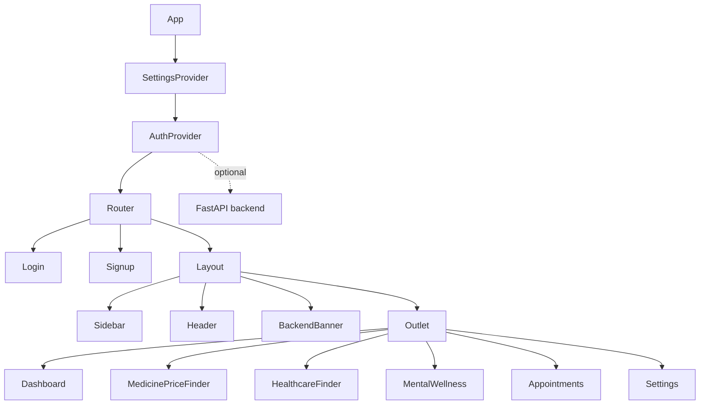

# Design: HealthBridge AI

## Architecture

A single-page React app with client-side routing. State that must survive refresh lives in `localStorage` (keys prefixed `hb_`). A FastAPI backend exists but the frontend does not depend on it.

## Components and interfaces

| Unit | Responsibility |
|---|---|
| `Layout`, `Sidebar`, `Header`, `NavItem` | Shell, responsive drawer, header search, notification menu |
| `DashboardCard`, `Modal`, `AuthShell` | Reusable UI |
| `AuthContext` | Real login via API, or demo login stored as `hb_demo_user` |
| `SettingsContext` | Display preferences applied as classes on `<html>` |
| `useLocalStorage` | `useState` that persists to `localStorage` |
| `api/client.ts` | Typed fetch wrapper for the backend |

## Key decisions

- **Demo login instead of a required backend.** The backend could not run on the build machine, so the demo user keeps every page reachable without credentials.
- **Deterministic demo pricing.** Prices are scaled from a hash of the drug name, quantity, and insurance flag. Different inputs give different, repeatable fictional prices.
- **Crisis detection is prefix-based.** Patterns have no trailing `\b`, so "suicidal" matches. Both the frontend (`getResponse`) and backend (`CRISIS_PATTERNS`) share this rule.
- **Local-date parsing.** Dates are parsed from `YYYY-MM-DD` parts, not `new Date(string)`, to avoid a UTC off-by-one for US users.
- **Accessible switches.** Toggles are `<button role="switch">` with accessible names.

## Data model (backend)

`User`, `JournalEntry`, `Appointment`, `ChatSession`, `ChatMessage` (SQLAlchemy, SQLite for dev). Chat messages carry `is_crisis_flagged`.

## Testing strategy

Vitest + jsdom + Testing Library render the real `<App />` at a path and drive it with user events. Tests cover requirements 1 to 6. Backend crisis patterns were checked with a one-off Python script. Visual layout and the backend are not covered.

## Safety and data guardrails

- `scripts/check-demo-data.mjs` fails on real pharmacy or discount-card names.
- Steering file `mental-wellness-safety.md` loads when wellness code is edited.
