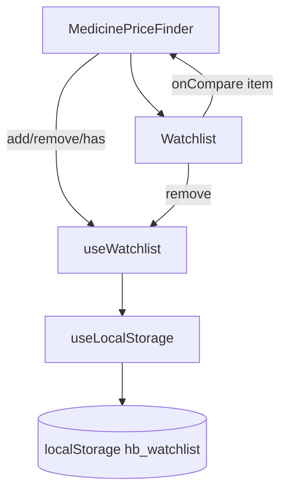

# Design: Medicine Watchlist

## Overview

Add a persisted list of saved searches to the Medicine Price Finder. No backend and no new dependency. It reuses `useLocalStorage`.



## Components and interfaces

```ts
interface WatchlistItem {
  id: string;            // `${name.toLowerCase()}|${dosage}|${quantity}`
  name: string;
  dosage: string;
  quantity: string;
  showGeneric: boolean;
  hasInsurance: boolean;
  savedPrice: number;    // best demo price when saved
  savedAt: string;       // ISO timestamp
}
```

- `useWatchlist()` returns `{ items, has(id), toggle(item), remove(id), isFull }`. Maximum 10 items. `toggle` returns `'added' | 'removed' | 'full'` so the UI can explain a refusal.
- `Watchlist` (component) renders the list, remove buttons, and "Compare again". It receives `items`, `onRemove`, and `onCompare`.
- `MedicinePriceFinder` owns the "Save to watchlist" toggle button and restores inputs when `onCompare` fires.

## Decisions

- **No price-change display.** Demo prices are a deterministic function of the inputs, so "Compare again" always returns the same price. Showing a delta or alert would invent data and break the product rule. The panel shows the price at save time, labelled as demo.
- **Id from inputs.** A derived id makes duplicate detection trivial and keeps the toggle idempotent.
- **Defensive load.** Stored JSON is validated (array of objects with the expected string and number fields). Anything else falls back to an empty list.
- **Local only.** `localStorage` key `hb_watchlist` is covered by the existing "delete all `hb_` keys" action.

## Error handling

| Case | Behavior |
|---|---|
| Storage blocked or full | `useLocalStorage` keeps working in memory |
| Malformed stored value | Treated as empty list |
| 11th item | Not added; inline message explains the 10-item limit |

## Testing strategy

UI tests with Vitest and Testing Library, in `src/test/watchlist.test.tsx`:
save, duplicate toggle, remove, limit of 10, persistence across remount, malformed storage, compare again, and a check that no price-change text appears.
